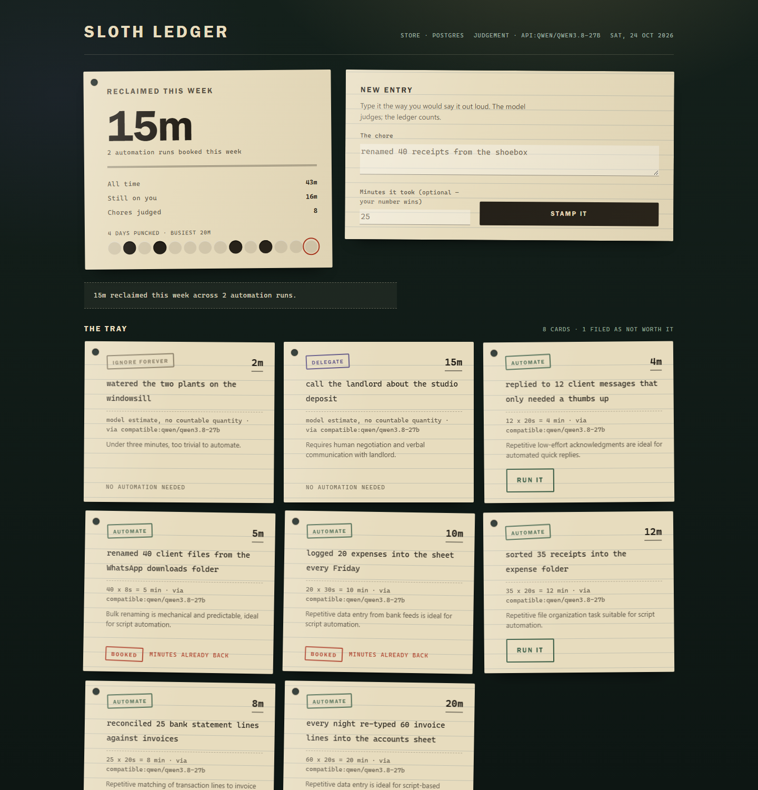
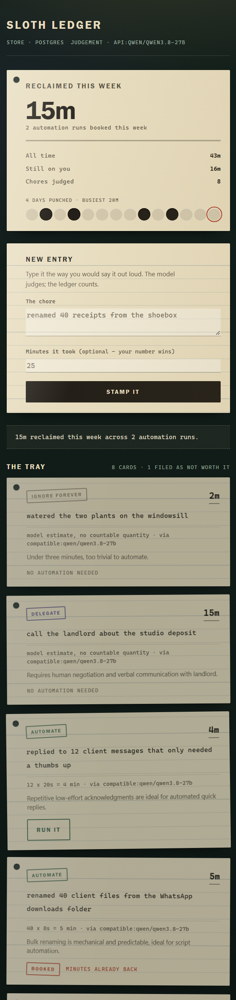
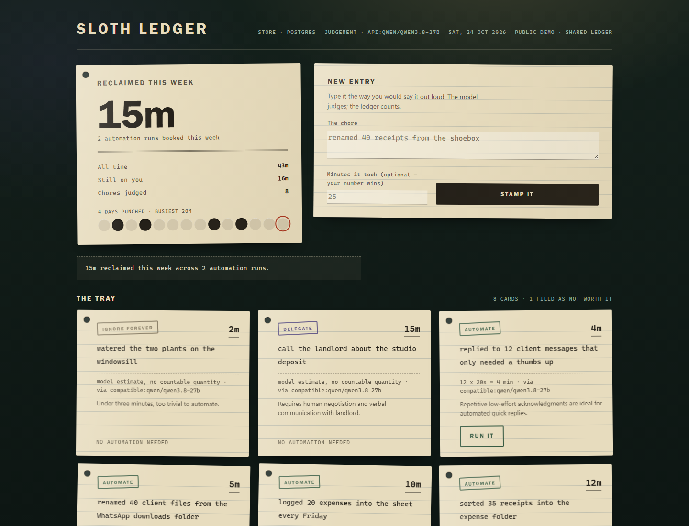

# Sloth Ledger — the receipt for your time

A ledger of the minutes you get back. You describe a chore in plain English, an
open-weight model estimates what it costs by hand and whether it is worth
automating, and every time an automation actually runs, the reclaimed minutes
land in a real time-series database. The dashboard answers one question
honestly: *how much time did this actually save me?*

Open-source AI is not decoration here. The judgement comes from an open-weight
model (`qwen/qwen3.8-27b`, served by Groq's OpenAI-compatible API), the
arithmetic comes from the database, and the deterministic rules floor still
answers with no key and no network — so the ledger never stops working.

**Live demo:** <https://sloth-ledger.onrender.com> — a free Render web service
that sleeps when idle, backed by Tiger Cloud. It is a shared ledger, so writes
are rate-limited per visitor and the page labels itself a public demo.

## Why the numbers can be trusted

The model is allowed an opinion, never a figure:

- If your description contains a countable quantity (`40 receipts`), the minutes
  come from **count × per-item rate**, a table you can read and edit.
- If you measured the chore yourself, your number wins.
- Only when there is nothing countable does the model's estimate stand, and it
  is clamped to 1–480 minutes.
- Totals and weekly rollups come from SQL, never from generated text.

In the demo below the model proposed 20 minutes for `renamed 40 receipts`; the
ledger booked 13, because 40 × 20 seconds is arithmetic and arithmetic belongs
to the database. Each card prints the sum that produced its figure.

| | |
|---|---|
|  |  |
|  | |

## Run it

```bash
python app.py            # http://127.0.0.1:8787
```

Python 3.11+, standard library, no pip install. With no `.env` the app uses the
rules floor for judgement and a local SQLite file for storage — it runs on a
plane, in a cabin, or with the Wi-Fi off. Add keys to switch the lanes on.

## Deploy your own

`render.yaml` is a working Render blueprint: free plan, Python 3.12, health
check on `/healthz`, one dependency (`pg8000`), and two secrets (`DATABASE_URL`,
`MODEL_API_KEY`) left as `sync: false` so they are pasted into the dashboard and
never committed. Point Render at this repo, apply the blueprint, and it builds
itself. Step-by-step notes are in `docs/deploy.md`; the service as it actually
runs — region, plan, environment, verification transcript — is recorded in
`docs/DEPLOYED.md`.

The free instance sleeps after fifteen minutes of inactivity. That is survivable
here because the reclaimed minutes live in Tiger Cloud, not on the instance's
ephemeral disk: the web process is disposable, the ledger is not.

## Lanes

Copy `.env.example` to `.env` and fill in what you have.

| Lane | Setting | What it buys |
|---|---|---|
| Open-weight model API | `MODEL_BASE_URL`, `MODEL_API_KEY`, `MODEL_NAME` | Judgement from `qwen/qwen3.8-27b` on Groq (any OpenAI-compatible endpoint works, including a local server) |
| Rules floor | nothing | Same output shape, no key, no network, always available |
| Tiger Cloud / TimescaleDB | `DATABASE_URL` | Hypertable + continuous aggregate rollups |

With no `DATABASE_URL` the store is one SQLite file. With it, reclaimed minutes
go into a `ledger.reclaimed` hypertable and the top-automations panel reads a
continuous aggregate the database maintains itself.

## The schema

See `docs/SCHEMA.sql`. Two tables and one continuous aggregate:

- `ledger.chore` — what you did, what it cost, and the verdict (`automate`,
  `delegate`, or `ignore forever`).
- `ledger.reclaimed` — a hypertable of minutes actually handed back, one row per
  automation run.
- `ledger.reclaimed_daily` — a `time_bucket('1 day', ...)` continuous aggregate,
  refreshed by policy, so the dashboard query stays small as history grows.

The app connects as a least-privilege role (`sloth_app`), not the database
owner. `docs/SCHEMA.sql` includes the grants it needs.

## Demo data, honestly

The eight entries shipped in `tools/seed_demo.py` are a labelled synthetic
corpus for a freelance designer — illustrative chores, not measurements of a
real person's week. Replace them with your own before claiming any savings.
Minutes booked in the screenshots come from those entries.

The hosted demo is a shared ledger, so its totals move as visitors add chores and
run automations. The screenshots and the figures in the DEV post are the snapshot
taken at publication; the live counters are allowed to disagree with them.

## Tests

```bash
python tests/test_ledger.py     # estimate reconciliation, verdicts, idempotency
python tools/smoke_http.py      # walks the real HTTP surface (server running)
```

Both use the standard library only. `SLOTH_FORCE_RULES=1` pins the deterministic
floor so a model upgrade cannot change expected verdicts mid-suite.

## Licence

MIT. See `LICENSE`.
